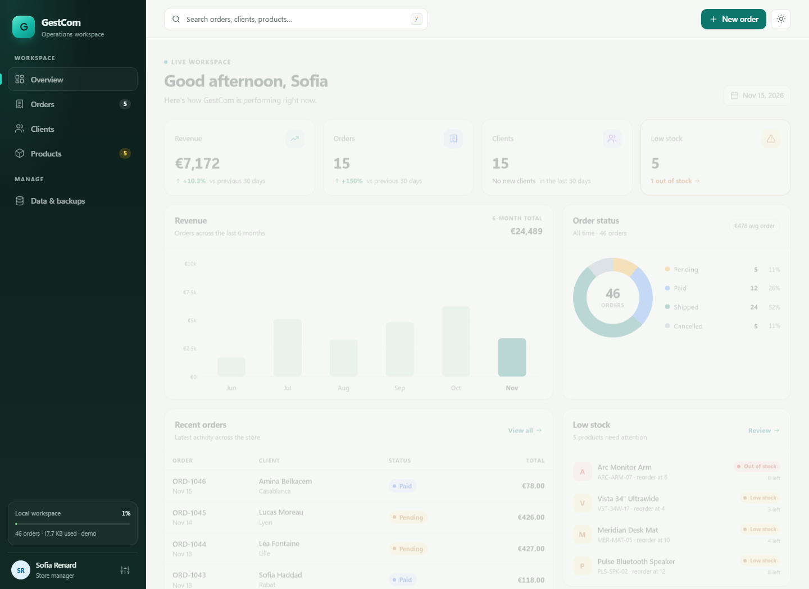
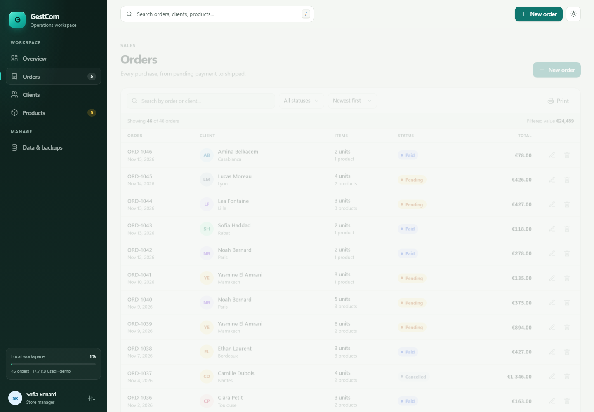

# GestCom

**A local-first operations workspace for small stores.** Manage clients, products, and orders from one clean dashboard — with inventory alerts, revenue insights, CSV exports, and JSON backups. Built with plain HTML, CSS, and JavaScript. No backend, no dependencies, no build step.

**Live demo:** [soufiane-x2.github.io/gestion-entreprise](https://soufiane-x2.github.io/gestion-entreprise/)



## Why this exists

GestCom started as a PHP/MySQL course project for managing clients, products, and orders. This version keeps the same domain and rebuilds it as a self-contained front end that runs anywhere — so the product thinking, UX, and front-end work can be explored without a database or a server.

The original PHP code, database dumps, and credentials are **not** part of this repository.

## Highlights

- **Live dashboard** — revenue trend for the last six months, order-status split, recent activity, low-stock watchlist, and best sellers.
- **Orders** — multi-line orders with live totals, client selection, statuses, delivery notes, and safe deletion.
- **Clients** — contact details, city, customer-since date, order count, and lifetime value.
- **Products** — prices, categories, stock meters, and reorder thresholds that drive low-stock alerts.
- **Find anything** — per-view search, filters and sorting, plus a global search palette (press `/`).
- **Own your data** — one-click JSON backup/restore and CSV exports for clients, products, and orders.
- **Feels right everywhere** — light, dark, and system themes; layouts from 320 px phones to wide desktops; print styles for order lists.
- **Accessible by default** — keyboard navigation, focus management, labelled controls, visible focus rings, and reduced-motion support.



## Tech stack

| Layer | Choice |
| --- | --- |
| Markup | Semantic HTML, inline SVG icon sprite |
| Styling | Modern CSS: custom properties, grid, container-friendly responsive rules |
| Behaviour | Vanilla JavaScript (ES2017+), hash routing, native `<dialog>` |
| Storage | `localStorage` under `gestcom.workspace.v1` |
| Build | None — open the folder and go |

No frameworks, no runtime dependencies, no network calls.

## Run it locally

```bash
git clone https://github.com/SOUFIANE-X2/gestion-entreprise.git
cd gestion-entreprise
npx serve .
```

Then open the printed URL. Any static server works:

```bash
python -m http.server 8080
# or
php -S 127.0.0.1:8080
```

Opening `index.html` directly also works in browsers that allow `localStorage` on `file://`, but a local server is recommended.

## Demo data

On first launch GestCom seeds a deterministic sample workspace: **15 clients, 18 products, and 46 orders** spread across the last six months, with a realistic mix of statuses and stock levels. The dashboard is populated immediately, so there is nothing to configure before exploring.

From **Data & backups** you can:

- **Export JSON** for a complete, restorable snapshot.
- **Export CSV** for clients, products, or orders.
- **Import JSON** to replace the workspace with a backup.
- **Reset demo** to restore the original sample data.
- **Clear everything** to start from an empty workspace.

## Deploy to GitHub Pages

1. Push this folder to a GitHub repository.
2. Open **Settings → Pages**.
3. Under **Build and deployment**, choose **Deploy from a branch**.
4. Select the `main` branch and the `/ (root)` folder, then save.

The app is entirely static, so no configuration or build step is required.

## How the data model works

```text
Client   id, firstName, lastName, email, phone, city, gender, createdAt
Product  id, sku, name, category, price, stock, reorder, createdAt
Order    id, number, clientId, date, status, note, items[], createdAt
Item     productId, qty, unitPrice
```

- Order totals are derived from line items, never stored twice.
- A client with orders and a product used in orders cannot be deleted until those dependencies are removed — the UI explains why instead of silently failing.
- Imports are validated and normalised; malformed backups are rejected with a readable message.
- All writes are persisted to `localStorage`; the sidebar shows the approximate footprint against a 5 MB budget.

## Project structure

```text
gestcom/
├─ index.html            App shell, icon sprite, theme bootstrap
├─ css/
│  └─ style.css          Design tokens, layout, components, responsive + print rules
├─ js/
│  ├─ store.js           Schema, seed data, validation, CRUD, stats, import/export
│  └─ app.js             Router, views, dialogs, search, theme, data tools
└─ assets/
   ├─ favicon.svg
   └─ images/            README screenshots
```

## Quality checks

- Lighthouse (desktop, dashboard): **Accessibility 100 · Best Practices 100 · SEO 100**.
- Verified at 320, 360, 400, 560, 768, 900, 1024, and 1440 px with no horizontal overflow.
- Tested end to end: client/product/order CRUD, validation, blocked deletes, filters, global search, theme switching, persistence across reloads, JSON round-trip, and empty states.

## Privacy

Everything lives in the browser. There is no backend, no analytics, and no outbound request. Clearing site data removes the workspace, so keep a JSON backup if the data matters.

## License

[MIT](LICENSE)
